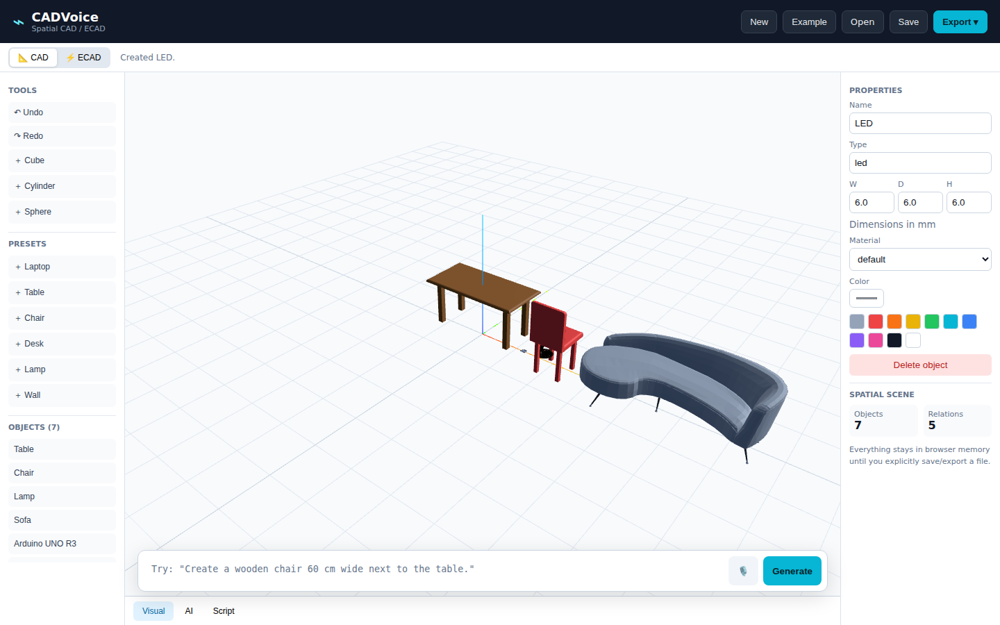
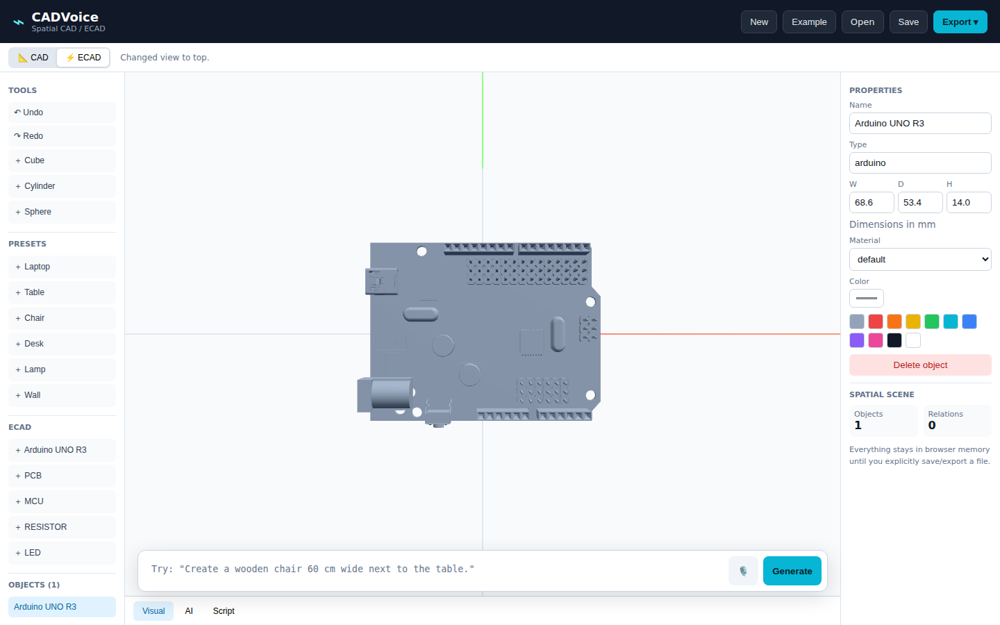

# CADVoice

CADVoice is a local-first, browser-based natural-language CAD/ECAD scene builder. Describe a design in plain English, refine object properties, inspect the scene in a 3D viewport, and export a model or source file. Prompts and project files are processed in your browser; nothing is sent to a server unless you turn on the optional AI backup described below.

> **Project status:** early-stage, tested prototype. It is not a certified CAD kernel. Check exported geometry and manufacturing dimensions in your CAD/EDA tool before using them commercially. CADVoice has no electrical-rule checking, constraint solver, or full parametric history.

## Screenshots





## What's new in this version

- **Trained language model.** Commands are understood by a logistic-regression intent classifier and a CRF slot tagger, trained on templated and hand-written data. They run in the browser with no network request. The earlier Naive Bayes model is removed.
- **Real 3D models.** Chairs, tables, sofas, lamps, Arduino boards, ATmega, resistors, and LEDs are real, openly licensed models rather than built-in shapes. Licences and authors are listed per model in `public/models3d/catalog.json`.
- **Optional AI backup (Google Gemini).** When the local model is unsure, a Gemini key on your own server can classify the command. Off by default.
- **Everything from before:** the CAD/ECAD workspaces, properties panel, undo/redo, project save/open, and the full export set.

## Features

- **CAD and ECAD workspaces** with a Z-up scene, orbit/pan/zoom camera, and top, front, side, and fit views.
- **Natural-language commands** for creating, moving, resizing, scaling, recoloring, rotating, renaming, selecting, duplicating, and deleting objects; spatial relations ("next to", "on top of"); CAD/ECAD mode; undo/redo; and export.
- **Real 3D models**: Arduino UNO R3, Nano, and Mega, Raspberry Pi Pico, ESP32 DevKit, ATmega328P, LED, resistor, capacitor, push button, chair, table, sofa, and lamp. Built-in parametric shapes remain for laptops, walls, cubes, cylinders, spheres, and PCBs.
- **Project files** in `.cadvoice` JSON format, with validation on open.
- **Exports:** STL, OBJ, GLB, OpenSCAD, CadQuery (Python), OpenJSCAD, AutoLISP notes, PDF scene summary, PNG viewport capture, ECAD JSON, and BOM CSV.
- **Voice input** where the browser supports the Web Speech API. Typed commands always work.
- **Example project** with a detailed Arduino UNO R3 scene in `public/examples/arduino-demo.cadvoice`.

## Requirements

- Node.js 20 or newer
- npm
- Python 3.9 or newer, only to retrain the language model or run the Python tests. The app itself does not need Python.

## Run locally

```bash
npm install
npm run dev
```

Open the address Vite prints (normally `http://localhost:5173`). To build and preview the production bundle:

```bash
npm run build
npm run preview          # http://localhost:4173
```

## Try these commands

```text
Create a wooden table 120 cm wide
Create a silver laptop 32 cm wide with the screen open at 110 degrees
Add a red chair next to the table
Add a sofa behind the table
Add an Arduino UNO
Make the table 140 cm wide and blue
Move the chair 10 cm to the left
Make it twice as big
Duplicate the laptop
Show the top view
Switch to ECAD mode
Export as STL
Undo
```

Dimensions accept `mm`, `cm`, or `m`, and `W x D x H` forms. Geometry uses meters internally; the properties panel and script exports show millimeters.

## Optional: AI backup (Google Gemini)

The local model handles most commands. For unusual phrasing, you can let Gemini answer when the local model is unsure. This is off until you add a key:

1. Create a key in Google AI Studio.
2. Copy `.env.example` to `.env` and paste the key after `GEMINI_API_KEY=`.
3. Restart `npm run dev` (or `npm run preview`). The app sends commands to the backup only when the local model is unsure, and only if the key is set.

Protections:

- The key is read by the Vite server and sent to Google only in a request header. It is never sent to the browser and never written into the built app.
- Gemini can only choose one of the known command names. Any other answer is discarded.
- `.env` is git-ignored. Do not paste your key into an issue, chat, or screenshot. If you exposed it, revoke it and create a new one.
- The backup works with `npm run dev` and `npm run preview`. A static host serving only `dist/` has no server, so the backup stays off there.

## How the language model works

```
text ─► tokenizer ─► intent classifier (logistic regression) ─► intent
                 └──► slot tagger (linear-chain CRF, BIO) ──► entities (object, colour, size, relation …)
                                                              │
   existing rule-based executor (dimensions, placement, scene updates) ◄┘
```

- Training data lives in `ml/data/`: templates, vocabularies, out-of-scope examples, and a hand-written gold set. `data/legacy/nlp_commands.csv` is the original labelled set from the earlier version; it is kept for reference and is not used by the trainer.
- `npm run train:model` (`python ml/train.py`) regenerates `src/nlu/model/*.json`, `ml/reports/metrics.json`, and the parity fixture.
- The browser implementation in `src/nlu/` matches the Python one on every test case (see Tests).

Measured results are in `ml/reports/metrics.json` and summarised in [docs/MODEL_CARD.md](docs/MODEL_CARD.md).

| Measure | Result | Notes |
|---|---|---|
| Intent accuracy, hand-written gold set | 98.7% (n = 156) | Written by the project author in the training style, so optimistic |
| Intent accuracy, held-out phrasings | 87.1% (n = 1,640) | Phrasings never seen in training |
| Slot F1, gold set | 0.949 | Exact-span match, gold intents |
| Out-of-scope rejection | 61.9% (n = 21) | Weak; see limitations |
| Browser vs Python agreement | 49/49 intents, 310/310 tags | Fixed test inputs |

## Real 3D models and licences

Models are built by `tools/build_models.py` from openly licensed sources listed in `tools/models.config.json`:

- FreeCAD-library models (Arduino, Raspberry Pi, ESP32, LED, resistor, capacitor, button, ATmega328P, chair, table): **CC-BY-3.0**.
- Sofa and lamp (Khronos glTF-Sample-Assets): **CC-BY-4.0**.

Each model is fitted uniformly into the object's size box. A table you set to 140 cm wide is scaled to fit that box. Boards keep their own colours; other parts take the object colour.

## Tests

```bash
npm test                            # Node: legacy rule tests, JS/Python parity, Gemini backup, data checks
pip install -r tools/requirements.txt
npm run test:py                     # Python: data integrity and model quality gates
npm run build && npx vite preview --port 4173 &
pip install playwright && python -m playwright install chromium
npm run test:e2e                    # real-browser smoke test of the built app
```

Quality gates in `tests/py/test_nlu.py` fail the build if retraining drops gold intent accuracy below 95%, held-out accuracy below 85%, or gold slot F1 below 0.90.

## Project layout

```
index.html, src/main.jsx      app shell: scene, properties panel, exports, projects
src/nlp.js                    command executor (uses the trained NLU for intent and entities)
src/nlu/                      browser NLU: tokeniser, features, classifier, CRF decoder, backup client
src/nlu/model/                trained model weights and lexicons (generated)
src/realModels.js             real GLB loader and fitting; src/realModelMap.js type→model map
server/gemini.mjs             Gemini backup client (Node side only)
vite.config.js                build config and /api endpoints for the backup
public/models3d/              real 3D models (GLB) and catalog.json with licences
public/examples/              sample project
ml/                           training code, data, reports (Python)
tools/                        model build pipeline and config
tests/                        Node tests, Python tests, browser test, fixtures
data/legacy/                  the earlier labelled command set (reference only)
```

## Known limitations

- **Out-of-scope detection is weak.** About 62% of non-command sentences are rejected in the 21-example evaluation, so unrelated text can still trigger an action. More negative examples are the fix.
- **The hand-written gold set is small and not independent.** It is a regression test, not a benchmark from real users.
- **Not modelled:** wiring between parts, electrical netlists, routing, articulated parts (lids, screens; only the laptop screen-angle field works), and physical properties. The app reports these as unsupported.
- **Some device types are stand-ins.** "Desk" uses the table model, and ESP32 uses the ATmega model. Laptops and walls remain simple parametric shapes.
- **Exports** are STL, OBJ, GLB, OpenSCAD, CadQuery, OpenJSCAD, PDF, PNG, BOM, ECAD JSON, and project JSON. Exported geometry is approximate; check it before manufacturing.
- **Bundle size.** The language model is bundled into the app (about 2 MB), so the main JavaScript chunk is large. It loads once and works offline.
- **Voice** depends on the browser's Web Speech API. Firefox does not support it.
- **The AI backup** needs internet access and a valid key, and works only with the Vite dev and preview servers.

## Licence

Code and original data: MIT. See [LICENSE](LICENSE). Third-party models keep their own licences, listed in `public/models3d/catalog.json`. Vendored Three.js (via npm) is MIT.

## Contributing

See [CONTRIBUTING.md](CONTRIBUTING.md), the [code of conduct](CODE_OF_CONDUCT.md), and [SECURITY.md](SECURITY.md) for security reports.
