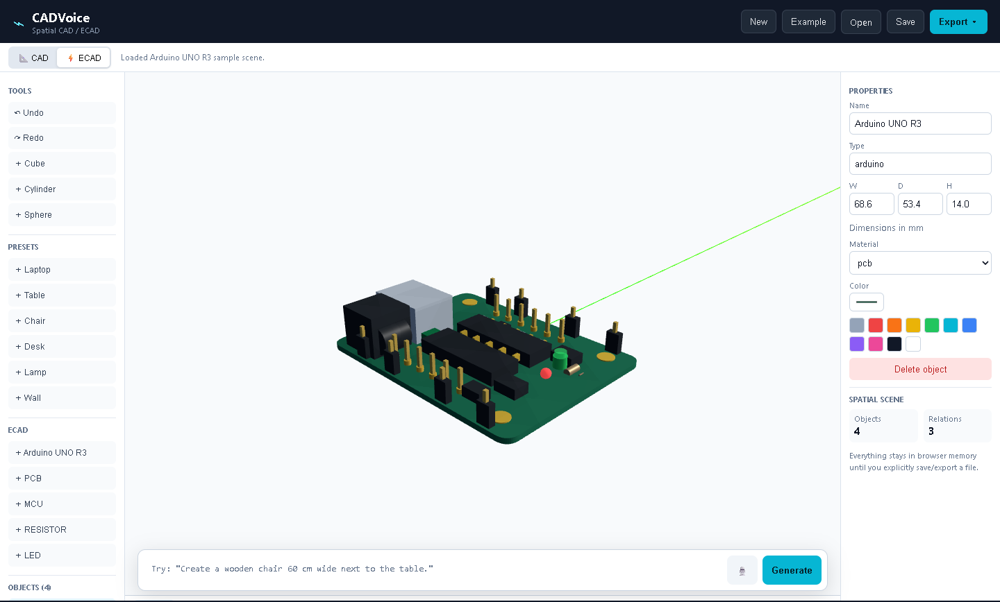
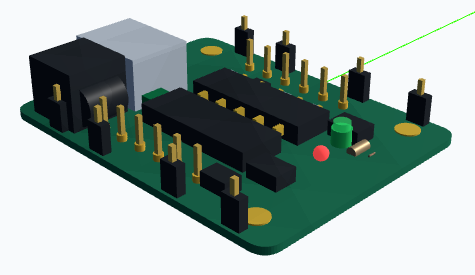

# CADVoice

CADVoice is a local-first, browser-based natural-language CAD/ECAD scene builder. Describe a design in plain English, refine object properties, inspect the scene in a 3D viewport, and export a portable model or source file. The application does not send prompts or project files to a server.

> **Project status:** CADVoice is an early-stage, tested prototype—not a certified or production CAD kernel. Validate exported geometry and manufacturing dimensions in your CAD/EDA tool before using them commercially. CADVoice does not provide electrical-rule checking, a constraint solver, or a full parametric history.

## Screenshots

The application screenshot includes the 3D viewport, object list, properties, and command input. The detail image shows the generated Arduino-style assembly.





## Features

- **CAD and ECAD workspaces** with a Z-up scene, orbit/pan/zoom camera, and top/front/side/fit views.
- **Natural-language scene commands** for creating, moving, resizing, recoloring, renaming, rotating, selecting, duplicating, and deleting objects; spatial relations; CAD/ECAD mode; and undo/redo.
- **Local intent model**: a small multinomial Naive Bayes classifier trained from the included CSV examples, with deterministic dimension, color, target, and spatial-relation extraction. It runs in the browser without an API key or network request. See [model details](#nlp-model-and-training).
- **Parametric visual assemblies** for furniture, laptop, PCB, and electronic components. The Arduino UNO R3 preset is a locally generated, detailed board assembly (PCB, connectors, headers, ICs, LEDs, and passives), not a vendor CAD file.
- **Starter project** with a detailed Arduino UNO R3 scene in [`public/examples/arduino-demo.cadvoice`](./public/examples/arduino-demo.cadvoice).
- **Project save/open** using `.cadvoice` JSON files, with input validation for imported projects.
- **Exports**: STL, OBJ, GLB, OpenSCAD, CadQuery/Python, OpenJSCAD, AutoLISP notes, PDF scene summary, PNG viewport capture, ECAD JSON, and BOM CSV.
- **Voice dictation** where the browser supports the Web Speech API; manual text entry always works.

## Requirements

- Node.js 20 or newer
- npm
- Python 3.9 or newer (only needed to retrain the local intent model; the application itself does not need Python)

## Run locally

```powershell
npm ci
npm run dev
```

Open the local address printed by Vite (normally `http://localhost:5173`). To create and serve a production build:

```powershell
npm test
npm run build
npm run preview
```

## Try these commands

```text
Create a wooden table 120 cm wide
Create a silver laptop 32 cm wide with the screen open at 110 degrees
Create a metal lamp on the table
Make the table 140 cm wide and blue
Move the chair 10 cm to the left
Duplicate the laptop
Show the top view
Switch to ECAD mode
Undo
```

Dimensions accept `mm`, `cm`, or `m`. Width/depth/height and `W x D x H` forms are supported. The viewport and exported geometry use meters internally; the properties panel and script exports display millimeters.

## NLP model and training

Training phrases and their held-out evaluation split are in [`data/nlp_commands.csv`](./data/nlp_commands.csv). The standard-library-only trainer writes the generated browser model to [`src/intent-model.json`](./src/intent-model.json):

```powershell
npm run train:model
npm test
```

The intent model classifies supported command categories; explicit parsers extract scene objects, dimensions, materials, colors, and spatial relationships. This is a compact intent model for the included domain, not a general-purpose language model or a fine-tuned transformer. Extend the CSV with representative, independently held-out examples before relying on new phrasing.

## Export notes

- STL is a mesh format and does not preserve colors. OBJ exports geometry; GLB preserves supported materials.
- OpenSCAD, CadQuery, and OpenJSCAD exports are generated source code. CADVoice does not execute user scripts.
- ECAD JSON and BOM CSV are lightweight interchange aids, not substitutes for a validated EDA design.
- AutoLISP export is a scene annotation file, not executable geometry automation.
- Browser speech recognition availability and language support depend on the browser and operating system.

## Privacy

Scene data stays in browser memory until a user explicitly saves or exports a file. No account, telemetry, database, or remote NLP service is configured. Browser voice recognition may be provided by the browser vendor; consult that vendor's privacy policy before enabling it.

## Third-party software and marks

CADVoice is distributed under the MIT License. Runtime dependencies are listed in [`package.json`](./package.json) and their notices are supplied by npm packages. Arduino® and UNO® are trademarks of Arduino SA; the Arduino-style model is generated locally by CADVoice and is not an official Arduino CAD asset or endorsement.

See [`CONTRIBUTING.md`](./CONTRIBUTING.md) and [`SECURITY.md`](./SECURITY.md).
